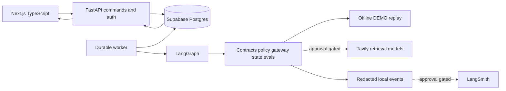
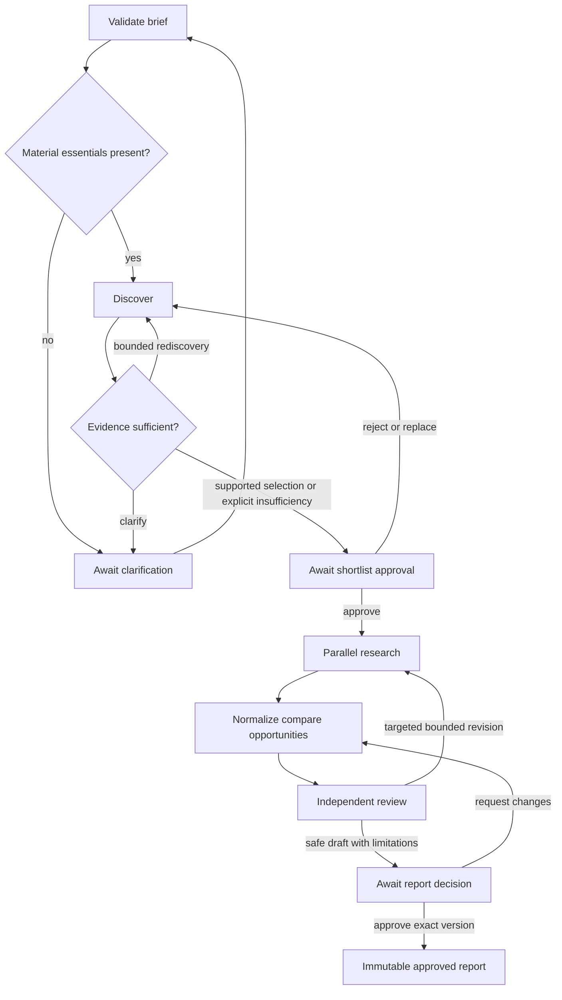

# Lather Lens architecture

## B14 security and bounded local concurrency

Ingress limits and generic validation errors precede private API handlers; BFF writes use bounded JSON, same-origin validation and HTTP-only credentials. Remote plaintext Auth/backend origins are refused; direct API browser CORS stays closed. Owner advisory locks serialize nonterminal-run admission (128, including approvals) and unexpired lease claims (four); three engine-shared long-held lane connections protect checkpoint/heartbeat capacity. Lease generations, approval hashes, immutable evidence/history and provider-neutral recorded-only execution remain authoritative. These defaults are engineering proposals, not business acceptance or distributed capacity claims. SECURITY_AUDIT.md, ADR 0015 and SECURITY_STAGE_RESULTS.md describe the audit, actual pool-starvation fix, measured results and retention/shared-limit gaps. No B15 or subsequent stage starts automatically; older stage notes below are historical.

## B13 current evaluation architecture

Versioned `lather-golden-v1` executes the existing 17-case catalog with independent schema/math/tool/permission/approval/trajectory and durable recovery checks. An isolated golden job plan reuses the leased worker and Postgres checkpointer; production refuses evaluation plans before tools. Hash-bound human review/rating endpoints require explicit server role grants and never count fixture receipts. Sanitized local traces have an explicit capped LangSmith SDK exporter; automatic app tracing stays disabled and no remote export was performed. Proposed baselines are immutable versions awaiting user review, compared against independent actual runs. Read EVALUATION_SPEC.md, ADR 0014 and EVALUATION_REPORT.md for results and original-gate limits. B14 and subsequent stages have not started; older stage notes below are historical.

## B12 isolated replay and recovery

B12 adds exact versioned response tapes, pinned single-scenario DEMO job plans, test-only server capabilities/creation, a separately gated interruption worker and actual persisted failure/recovery summaries. Existing owner-protected journals, leases, Postgres checkpointer, independent lanes and both approvals remain the execution path. Production refuses injection at configuration/API/worker/model boundaries. Model fixtures are synthetic frozen rule-output projections; no provider is called or selected. See CHAOS_SPEC.md, ADR 0013 and CHAOS_STAGE_RESULTS.md. B13 and later stages have not started; older stage notes below are historical.

## B11 immutable history layer

`history_types.py`/`history.py` add versioned read-only exact report version metadata and a pure comparison of approved frozen snapshots. Existing immutable reports rows supply (run, version); no duplicate table/migration or mutable historical rewrite. Stable host/name brand and exact SKU/variant keys are independent of run-local IDs. Only advancing, scoped, intact dated evidence can support changed/newly observed/source-reported gone; missing/denied/cached/conflicting evidence stays unknown/stale. BFF allowlists serve `/api/history/diff`, version listings and exact-version workspace reads. Frontend retains the source timeline/card design with actual counters and evidence. See HISTORY_SPEC.md and ADR 0012. Provider-neutral quality benchmark/BRD acceptance remain unchanged. B12 and later stages not started; earlier notes below are historical.

## B10 current persisted-report architecture

Report presentation is frozen with immutable analysis-report-1.0 before hashing/review; graph pin workflow-1.2. `report_types.py`, `reporting.py` and `report_exports.py` supply typed owner-protected workspace/history/report projections and deterministic approved-save downloads. `services/analysis.py` freezes the brief/evidence/coverage/positioning/shortlist. Next BFF explicit run routes retain HttpOnly credentials and same-origin/idempotency checks; real screens poll persisted events and display actual saved state. No route imports preview fixtures. See REPORT_SPEC.md and ADR 0011 for exact approval/immutability/citation semantics, compatible legacy projection and old-checkpoint refusal. Model-neutral boundaries remain unchanged; no live provider selected. B11 semantic history and live-quality acceptance remain pending. Older architecture stage snapshots below remain historical.

## Current B09 analysis implementation

B09 adds `harness/analysis_types.py`, separate evidence_catalog/normalization/analyst/reviewer/correction modules and fenced `services/analysis.py`. Workflow version is now workflow-1.1 with actual same-item normalization, conditional grounded hypotheses, independent review receipts and targeted immutable revisions. Migration 0006 suppresses unit prices lacking verified same-item eligibility while preserving raw legacy observations. Read ANALYSIS_SPEC.md, ADR 0010 and ANALYSIS_STAGE_RESULTS.md for contracts, actual tests and limitations. Older B08 inventory-only notes below are historical. No provider/model selection, paid benchmark, full report/export/UI/history stage or deployment has started.

# Current durable workflow implementation

B08 now uses `backend/app/workflow.py`, `worker.py`, `harness/lease.py` and `harness/checkpointer.py`: typed conditional LangGraph, actual Postgres checkpoints/pending writes, owner-scoped database-clock leases/heartbeats/fences, durable interrupts and committed event polling/SSE. Research fan-out remains the existing independently journaled ThreadPoolExecutor inside a graph node. Managed final approval queues save; completion is a worker transaction after verifying the approved immutable report. Read [WORKFLOW_SPEC.md](WORKFLOW_SPEC.md), [ADR 0009](adr/0009-fenced-owner-postgres-graph.md) and [WORKFLOW_STAGE_RESULTS.md](WORKFLOW_STAGE_RESULTS.md) for implementation boundaries and executed evidence.

This current-stage note supersedes older planning statements that the graph/worker do not exist. Analysis/review are labeled DEMO inventory/mechanical nodes used to verify orchestration. Strategic model selection, independent semantic adjudication, B09/B10 report quality and real frontend run controls remain future work; no business requirement or acceptance target is weakened.

## Public research implementation update

The requested Researcher/evidence stage now has max-three independent lanes through a typed public gateway, immutable source snapshots and claim links, safe destination/access rules, per-wire shared accounting and owner-bound durable state. See RESEARCH_SPEC.md and ADR 0008. All external HTTP/news/DNS is recorded DEMO; live activation is unavailable. This adds no final model choice, full LangGraph worker, Analyst/Reviewer, report/history generation or frontend wiring. Older planning status below is historical; original source requirements remain authoritative.

## Gateway/Scout implementation update

The requested discovery slice now exists; see SCOUT_SPEC.md and ADR 0007. Only the harness can dispatch its Tavily-compatible recorded transport; there is no real-key factory or paid path. Postgres locks/journal/source kinds and existing owner-bound decisions implement a durable application review interrupt. This is not a LangGraph interrupt/checkpointer: full worker/leases/fencing, Researcher, final report and live integrations remain later stages. The prior UI stage also implemented five screens with real Brief persistence and four labeled DEMO previews; older status paragraphs below are historical.

Architecture baseline, 25 October 2026. BRD governs business targets, supplied HTML visual fidelity, PRD v1.1 implementation proposals. See REQUIREMENTS_TRACEABILITY.md and stage results for actual implementation status. Scaffold and backend Auth/owner-storage now exist; local Supabase integration is documented in AUTH_STORAGE.md and ADR 0006. Model/search integrations, full UI, durable agent execution and deployment remain unimplemented. No model/provider choice or hosted compatibility is established by local storage tests.

## Components and boundaries

Use FastAPI/Pydantic Python, LangGraph, Next.js TypeScript/Tailwind, Supabase Postgres/Auth, Tavily, configurable model adapter and opt-in LangSmith. Build harness contracts/policy/replay evaluations before agents and live tools. External writes, accounts, contact, purchases, publication and automatic business actions are absent. Existing staging site/repository remain outside scope.

FastAPI checks owner/input, transactionally persists run/job and returns its identifier. Research does not live inside HTTP requests. Separate workers lease jobs and drive LangGraph; all agent tools and model calls pass through the harness. UI renders persisted state and sends explicit decisions; client state cannot approve a run. Browser bundles contain no provider/service-role secrets.

Proposed paths: backend/app/{api,auth,domain,harness,agents,adapters,workflow,persistence,services}/ and worker.py; frontend/app/ and components/; evaluations/fixtures/ and reports/. Alembic in backend/migrations/ owns domain schema; supabase/ contains Auth/RLS bootstrap and ordered integration setup, never competing definitions of the same tables.

## Harness and agents

The user's quality-first/provider-neutral decision is recorded in ADR 0005 and REQUIREMENTS_QUALITY_AUDIT.md. It supersedes PRD section 5's Fireworks-first consideration without editing the original source. No preference or default for Fireworks, Nebius or OpenAI is selected. MODEL_BENCHMARK.md must be reviewed and executed under separate approval before final model selection; cost/latency do not contribute to quality ranking. Spending caps still limit authorization, and exhaustion cannot trigger an invisible cheaper downgrade.

Proposed dedicated ModelAdapter separates domain agents from vendor SDKs through canonical requests, structured responses/tool intents and typed errors. A registry resolves explicitly configured, evaluated role profiles; no adapter directly runs tools. Versioned per-role profiles and per-operation model provenance are required. Current schema 1.0 Versions only holds one provider/model tuple, so multi-role provenance requires an explicit future schema migration; it is not implemented yet. MODEL_IMPLEMENTATION_PLAN.md specifies interfaces, capability/error normalization and benchmark dependencies.

RunContext contains owner/run IDs, brief version, trace ID, model/prompt/tool/schema/graph versions, budget reservations/usage, deadline, approval state and checkpoint pointer. Pydantic validates every agent/tool input/output before persistence and handoff. ToolRequest carries logical operation ID, agent, typed arguments and attempt. ToolResult carries validated payload or classified error, source references, times and usage. Error classes distinguish transient, denied, unavailable, invalid, exhausted and cancelled.

Gateway order: validate -> enforce run/gate/agent permission -> atomically reserve budget -> validate URL destination -> versioned cache/replay or bounded execution -> validate output -> persist completion/event -> reconcile usage. Models share this boundary. Unknown paid cost blocks dispatch unless an approved upper bound exists. Uncertain in-flight usage is not silently refunded.

Scout uses public search. Researcher uses public search/retrieval. Analyst normalizes deterministically and synthesizes stored evidence. Reviewer independently checks schema/math/support/freshness and reviews stored evidence; it does not inherit Analyst conclusions as truth. Orchestrator routes, manages state/retries and approvals. Targeted new research returns to Researcher. These are four logical agent roles plus an orchestrator, not five mandatory autonomous services/model calls. Retrieved text cannot override prompts, policy or approvals.

## Workflow

Zero credible candidates requires clarification or unresolved stop, not empty approval. One/two candidates need recorded insufficiency; three remains the normal target. Any active node may pause, cancel, fail or preserve partial work. A partial draft is never auto-approved. Proposed reviewer revision default: one targeted revision, configurable and recorded; human-requested changes also respect budgets/deadline.

Approval binds owner, run, request ID, artifact version/hash and expected state. A transaction checks identity, current version and idempotency, records decision and enqueues work. Changed drafts invalidate previous approval applicability. Final approval freezes an immutable report version. Drafts, sources, pending approvals and failures are persisted before approval. Approval never authorizes external business actions.

## Storage and crash recovery

Postgres stores profiles, briefs, runs/events, jobs, tool_operations/results, competitors/candidates, products/price observations, sources, claims/findings, reports/versions, approval requests/decisions, evaluations and usage. Jobs and operation tables elaborate PRD durable execution. Owned records and references preserve owner/run scope; immutable report snapshots link immutable observations.

LangGraph Postgres checkpoints reference durable logical operation IDs. Unique constraints deduplicate operations/events/commands. Per-run event sequence supports cursor replay. Leases carry worker, expiry and fencing generation; stale workers cannot commit. Network calls never hold open database transactions.

Persist completed operation results and journal/event intent atomically; checkpoint points to operation IDs. After crash, reconcile checkpoint with the completion journal before dispatch. Test crashes before/after result commit and checkpoint commit. Reuse completed operations. Remote read calls are at-least-once in the response-before-local-commit crash window; local idempotency cannot guarantee exactly-once remote billing. Track uncertain calls conservatively within budget.

Cancel persists intent, stops dispatch and cooperatively interrupts work while retaining results. Proposed Pause stops at a safe checkpoint; no promise of immediate remote interruption or refunds. SSE and polling share persisted cursors; polling uses /events?transport=json&after=...&limit=.... Expired event cursors return explicit resync status.

## Evidence and arithmetic

Sources have canonical public URL, title, publisher, retrieval date, content hash, access status and permissible excerpt. Claims have fact/interpretation/hypothesis/competitor-marketing type, snippet/source links, review/support status and confidence rationale. A URL alone is not proof. Missing fields have reason-coded unavailable states and attempted retrieval metadata, never zeros or inferred facts.

Price observations record SKU/variant, Decimal amount, currency, pack quantity, weight basis/total pack grams, dates and source. Compute amount / total_pack_weight_g * 100 only for the same purchase item with known positive weight. Distinguish per-bar from pack total so pack quantity is not multiplied twice. No implicit FX, variant substitution or silent conflict resolution. Own price/weight are labeled owner inputs; no chart without comparable known values. Ingredient completeness is only as disclosed; reviews and marketing never prove medical efficacy or representative demand.

Schemas include every FR-03 field, including audience and packaging claims beyond the prototype table. Reports include every FR-07 section. Opportunities include evidence, rationale, potential benefit, assumptions and next step even when the prototype only labels Evidence/Assumes/Next.

## APIs and UI

Keep PRD routes: GET /health/live, /health/ready; POST /api/briefs; GET /api/briefs/{id}; POST /api/runs; GET /api/runs/{id}; GET /api/runs/{id}/events; POST /api/runs/{id}/cancel; POST /api/runs/{id}/shortlist-decision; POST /api/runs/{id}/report-decision; GET /api/runs/{id}/report; GET /api/history; GET /api/history/diff; GET /api/runs/{id}/export.

Proposed additional POST routes /api/runs/{id}/pause, /resume and /clarification support HTML controls and material clarification. Review these additions before implementation. Shortlist decision supports approve/reject/replace/rediscover; report decision approve/request_changes with version. Protected endpoints require JWT verification, owner scope, pagination/input bounds, stable errors and version conflicts. Start/decision keys bind owner, operation and payload; reuse with different payload conflicts. Generate TypeScript contracts from implemented OpenAPI later.

Supabase RLS complements server ownership. Isolate worker credentials and retain explicit owner-scoped queries even with elevated DB access. The worker cannot approve on behalf of a user.

Preserve five screens, board sizes, fonts/colors and interactions in UI_REFERENCE.md. Reference placeholder counts, fixed widths, quality scores and logs cannot become real results. DEMO labels stay visible in synthetic screens/exports. Proposed fit states are match/partial/no-match/unknown with rationale; score shows evidence coverage separately so unknown is not silently no-match. Maps label interpretation and unknown axes. Charts have text alternatives. Verify mobile, keyboard/focus, contrast and reduced motion; no fake activity animation.

## Errors security and observability

Timeout/429/5xx get initial attempt plus at most two additional attempts by default, bounded jitter/backoff and Retry-After within budget/deadline. Denied/robots-blocked pages do not get bypass retries. Model output repair is separate: proposed one repair, then explicit invalid result. Preserve successes and record report impact. Inject clock/RNG for deterministic tests.

Retrieval validates HTTP(S) URL parsing, DNS addresses, redirects and actual connection destination; blocks credentials/private/loopback/link-local/metadata addresses; bounds body size/time/redirects. Respect robots/access restrictions. Sanitize retrieved markup. Do not log keys, authorization headers, arbitrary query strings or raw prompts/private briefs. Add CORS/CSP, rate limits and dependency scans before release. Retention/deletion periods, backup RPO/RTO and operating budgets remain review decisions before hosting.

Local events capture versioned node/tool trajectories, redacted failures, latency and actual usage/cost. LangSmith is a required adapter but disabled by default and separately approval-gated; minimize approved trace content. Chaos requires server-side isolated test/DEMO authorization; production denies forged controls too.

## Evaluation and delivery

Use pytest for schema/math/policy/workflow/database tests, Playwright for UI, and versioned offline DEMO transcripts with injected clocks/IDs/RNG. D01–D17, T01–T08, S01–S04, UI01–UI06, P01 and H01 are planned in traceability. Each result records inputs, expected/actual behavior, outcome, limits and versions. Five-case failure cohort stays D04/D05/D06/D10/D12; strict security/math/approval/recovery gates also block release. Actual owner usefulness and real-source quality cannot be established by replay.

PRD hosting candidates remain Netlify frontend, Railway API/worker and Supabase. No resources, API calls or deployment occur here. Package/runtime/provider capabilities, pricing and hosting limits must be verified in a later approved stage, not asserted from memory. BACKLOG.md orders stage reviews; never start the next stage automatically.

## Contradictions and proposed resolutions

Original requirements remain unchanged. These proposals await review.

| ID | Tension | Proposed resolution |
| --- | --- | --- |
| C01 | Short input paths versus original filenames | Use screenshot-identified originals and retain hashes/names |
| C02 | BRD shortlist review when needed; PRD/HTML always two gates | Always enforce shortlist and final gates as stronger control |
| C03 | BRD requires 3–5 opportunities; PRD allows fewer unsupported | Retain target; flag fewer as insufficiency/unmet count, never invent success |
| C04 | HTML three retries; PRD two additional attempts | Show three total attempts/two retries from configuration |
| C05 | HTML retries 403 and implies fallback provider | Record denial; use permitted public alternate sources, no bypass or unapproved paid provider |
| C06 | HTML fixed counts, 94% coverage, logs and budgets | Use actual state; only visibly DEMO examples; three competitors when evidence permits |
| C07 | HTML lacks explicit rationale/benefit and summary/methodology; shorter data table | Include every BRD field/section in reference visual language |
| C08 | HTML Pause; clarification interactions absent from PRD API | Propose pause/resume/clarification commands with durable guards |
| C09 | Approve & save implies first persistence | Persist drafts/checkpoints first; approval freezes exact immutable version |
| C10 | History gone/latest current suggests discontinuation/freshness | Dated not-found/not-rechecked uncertainty; no current claim from old retrieval |
| C11 | Fixed chart bars/own unknown weight and indicative PRD price | Derive from comparable known observations; no guessed weight |
| C12 | PRD live integrations/deployment versus user no API/deployment | Offline design now; explicit approval for spending, egress, tracing, provisioning and deployment |
| C13 | BRD flexible simple UI/tools versus prescribed stack | Use required stack; roles do not force separate autonomous services |
| C14 | PRD at least 12 cases but lists 15 | Cover all 15 plus budget/idempotency D16/D17; no reduced threshold |
| C15 | BRD four-of-five recovery versus strict PRD CI | Measure cohort separately; critical regression still blocks release |

Review decisions: endorse proposed interpretations/endpoints/limits/scoring. Retention and approved budgets can be resolved before operations. No next implementation stage has begun.
