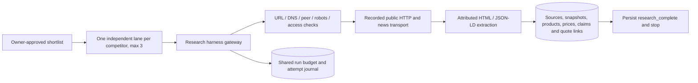

# Public research and attributable extraction

Requested stage: PRD delivery item 6 / backlog B07. Original BRD business targets, Claude UI reference and PRD v1.1 remain unchanged. Their authorized original filenames were inspected, including the BRD tables/acceptance targets and decoded UI templates. No frontend redesign, full LangGraph worker, Analyst, Reviewer or report stage is started here.

## Boundaries and execution

ResearchStore.begin loads the actual owner-scoped shortlist request/decision, verifies the artifact hash/version and selected competitor IDs, and projects an immutable research RunContext. The existing run deadline is never extended; used/reserved accounting is restored. ResearchGateway requires Researcher/research, the current tool version, typed public.retrieve/public.news arguments, and the approved gate. Database checks repeat before reservations/completions. No browser/model output can supply approval, fixture responses or source objects.

ThreadPoolExecutor runs up to three independent lanes. Each lane has its own source/result containers and competitor scope. A per-lane Postgres session advisory lock prevents duplicate active work without holding an HTTP-spanning database transaction. Shared run row locks protect cumulative call/cost accounting across Scout, research, failed requests and uncertain reservations. Network/DNS/robots/news operations remain under the gateway. Committed wire outcomes and task artifacts are reusable; a new process reads completed research with zero new recorded HTTP requests. This scoped locking/journal is not the later worker lease/fencing scheduler or LangGraph checkpointer.

Each lane starts with the approved canonical URL, follows at most two relevant same-domain public links, searches news for that exact competitor and retrieves at most two relevant article URLs. Data is never merged across competitor lanes. A blocked site can leave a partial lane while other lanes commit. Unknown in-flight reservations retain their accounting and produce an explicit limitation; there is no automatic refund or blind retry. After all lane artifacts persist, the checkpoint says research_complete while the run remains researching readiness. No later agent, report approval or business action executes. A completed task means bounded processing finished, not verified truth or every field being known.

## Public retrieval and access policy

All application HTTP/news/DNS in this stage uses hash-pinned synthetic DEMO recordings. RecordedWeb has no network/DNS fallback, matches method/URL/query and per-request sequence, and supports valid interleaving between independent lanes. No enabled live HTTP factory, API key lookup or paid transport exists. Environment keys cannot activate it. The native HTTPS connection primitive pins the validated numeric IP, checks the actual peer and retains original hostname TLS SNI/certificate verification; it is tested with controlled fake sockets, not a live TLS service. Live client streaming/interoperability, infrastructure egress filtering and security certification remain later approved work.

The policy uses [OWASP SSRF prevention guidance](https://cheatsheetseries.owasp.org/cheatsheets/Server_Side_Request_Forgery_Prevention_Cheat_Sheet.html): HTTP(S), public hostnames and standard ports only; no userinfo, credential query parameters, local/internal/numeric hosts, IP literals or control characters. Encoded path traversal/separator ambiguity is rejected. Every A/AAAA answer must be public; private/loopback/link-local/metadata/CGNAT/multicast/reserved and mapped/tunneled IPv6 are denied. The connection uses the pinned IP rather than re-resolving hostname, and the peer must equal it. DNS is checked separately for robots, each page hop and the fixed news endpoint. Redirects are bounded, revalidated and rechecked against robots; HTTPS downgrade and unsafe targets are denied. No image/iframe/script/remote JSON-LD context loads occur.

Robots matching implements named-agent group selection/merging, longest matching path, wildcard/end-anchor rules and Allow on equal specificity, following [RFC 9309](https://www.rfc-editor.org/rfc/rfc9309.html). Crawl-delay is an additional conservative extension, honored across same-origin requests with serialization. A missing robots file (404) permits access. Robots denial, invalid policy, 401/403, server errors or robots redirects fail closed. This is deliberately stricter than permissive RFC options; it is not a claim of complete REP conformance. The policy parser is bounded at 64KB; page bodies at 256KB. No cookie/login/proxy/access-control bypass is attempted. CAPTCHA, password forms, paywalls/isAccessibleForFree=false, noarchive/nosnippet directives and restricted statuses prevent extraction/content persistence. Restricted response bodies are removed from both the source and journal outcome.

Per-wire calls reserve before execution and count against the shared run budget. Timeouts/429/selected 5xx have at most three total attempts, Retry-After/backoff within the persisted deadline and a timeout bounded by remaining time. Access restrictions, invalid content, unsafe DNS/peer/redirects do not trigger bypass retries. Nonidentity compression and unsupported content types are unavailable. These recorded timeout/size behaviors and the native connection primitive do not establish hard live end-to-end deadline/preemption guarantees. Research currently uses zero actual provider spend; conservative accounting examples are DEMO, not billed costs or inferred provider prices.

## Extraction and attribution

Supported extraction is a conservative deterministic baseline: [Schema.org Product](https://schema.org/Product)/Offer/Review/NewsArticle JSON-LD, plus explicitly labeled visible HTML definition lists on a first-party product page. No LLM/vendor/model is selected; quality-first benchmark requirements remain in force. JavaScript-only, unsupported markup, malformed structures and unrecognized fields remain unavailable rather than being invented.

The extractor retains product/brand, SKU, variant/type, amount/currency, weight/unit, explicit pack quantity/basis, disclosed ingredients, marketing descriptions, positioning/audience, channels/packaging, public review excerpts, news and reported launches/publication labels. It ignores review author/customer identities. Marketing, review and news wording is attributed and flagged, never clinical efficacy or verified certification. Unknown/empty fields are null with explicit reasons; a source explicitly listing zero price remains zero. Ingredient disclosure is not assumed complete or representative.

Every successful retrieved page retains URL, observation time, raw UTF-8 HTML, SHA-256 of raw content, canonical extractable text, its separate hash, structured nodes and bounded links. Search snippets, page excerpts and robots policies have different evidence kinds. Source dates are retrieval observations; reported publication dates are as sourced, not independent freshness verification. Unavailable/denied resources retain URL/time/status/reason with null content and hash. A safe policy denial has no page request or page-call charge; robots checking itself still consumes an attempt.

Non-null observations carry source ID, exact canonical-text quote, quote hash and JSON pointer or visible-text locator. Persistence resolves immutable journal/source snapshots, recomputes extraction and validates quote membership/hash under the same owner/run/competitor. A forged body, unrecorded source or cross-lane source fails. New claim_sources.locator exposes drilldown. Raw hashes preserve original content while canonical quotes/locators support reproducible extraction. Data relationships are RLS/foreign-key protected; body HTML is stored as data, not executed or served as an active page.

Products are observations scoped to source and offer, not destructive SKU upserts. No missing SKU is replaced with a generated pseudo-SKU; internal UUIDs are distinct from a source's SKU. Multiple prices/ingredients/weights remain separate observations and explicit contradiction groups within the same competitor/SKU/variant/pack/currency. No averaging or silent winner selection occurs. Unknown SKUs are not merged across pages. An offer naming another item is retained as unmatched evidence, not attached to the wrong SKU's price.

Comparable total grams require explicit total-pack basis or explicit per-bar weight AND pack quantity in the same product/offer scope. Ambiguous "3 bars / 100g" is not resolved by guessing. Missing/ambiguous grams remain null, so the existing database price-per-100g computation is null. Currency is explicit ISO code; no implicit FX. Multiple variants/packs are never combined to manufacture a unit price.

## Storage/API and migration

Migration 0004 adds forced-RLS source_documents (raw/canonical snapshots) and research_tasks (typed per-competitor artifacts), quote locators, robots-policy source kind and nullable products.sku. Earlier migrations remain unchanged. Sources/products/prices/claims/claim_sources/events/usage and tool_attempts remain the shared durable journal. Completed source/task artifacts are immutable. Source ingress and claims are committed transactionally; failures retain earlier successful work.

GET /api/runs/{id}/research returns typed owner-scoped artifacts. GET /api/runs/{id}/claims/{claim_id}/evidence returns quote/source/locator relationships; source URLs/dates/content hashes are available through the existing source route. Wrong-owner/cross-run reads fail. No public write endpoint can inject HTML, an arbitrary source, tool arguments or a fake approval. Existing frontend research screens remain clearly labeled DEMO fixtures; this stage does not wire them to a live worker.

Downgrade refuses to invent SKUs or discard robots evidence to satisfy the older schema. The loss guard is tested with evidence remaining intact. Complete downgrade/reapply in integration first explicitly removes only disposable, owner/marker-checked local DEMO fixture rows, then destroys/recreates the dedicated test application's tables while preserving Auth. That cleanup is not production migration behavior. Any real downgrade requires a separately reviewed export/data plan.

## Evidence and remaining review items

RESEARCH_EVAL_RESULTS.json records 24 executed synthetic recordings. Unit tests additionally exercise public-address/URL/peer rules, TLS pinning/SNI with fake sockets, exact replay, body/hash integrity and approval boundaries. Real local Postgres tests cover three-lane overlap with a barrier, failure isolation, null unit prices, preserved contradictions, news quote links, forged/cross-lane data rejection, RLS/API ownership, process reload and guarded rollback. See RESEARCH_STAGE_RESULTS.md for actual commands/results and the complete changed-file inventory.

Quote presence/provenance is not genuine support: it does not prove a claim is entailed, correctly scoped, current, independent, medically valid or useful. All sources remain unreviewed and marketing claims flagged. The original >=90% support, >=4/5 useful reports and full failure/recovery/final-review gates remain unmeasured. The fixed BRD five-case failure cohort is not replaced with these favorable retrieval cases.

Saved for later review, without blocking this stage: approval/configuration/budgets for real HTTP/news, live DNS/TLS/streaming security verification, broader real-page/extraction quality corpus, model benchmark and optional model adapter selection, freshness/retention policies and JavaScript-only-site support. None is inferred as approved. Stop at this stage; no automatic next stage, deployment or spend.
